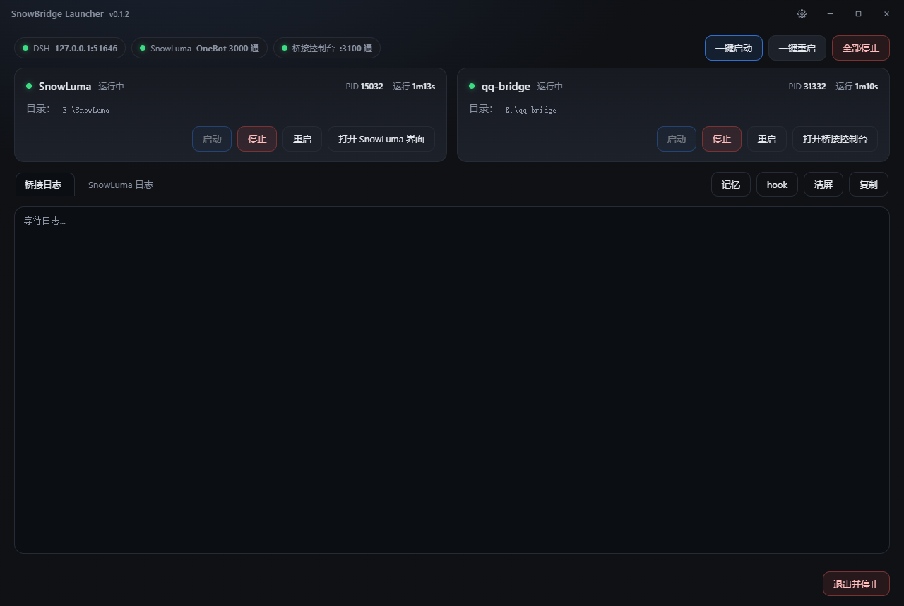

# SnowBridge Launcher
非官方第三方工具。 SnowBridge Launcher 与 SnowLuma、qq-bridge 的开发者无隶属或合作关系，未获其背书。本项目不包含、不修改、不再分发它们的任何代码或安装包；使用前请自行安装 SnowLuma 与 qq-bridge。
> 让 SnowLuma 和 qq-bridge 的启动变得更加方便




## 这是什么

将 SnowLuma 和 qq-bridge 的CMD窗口整合成一个桌面应用。

- **一键启动 / 停止 / 重启 / 接管**：启动顺序、重启、都可以使用 SnowBridge Launcher 一键操作
- **接管现有服务**：手动运行的 SnowLuma 和 qq-bridge 也可以自动接管
- **日志面板**：更加人性化的界面，丢掉笨重的cmd窗口将 桥接 / SnowLuma 两个页签整合到一个窗口
- **记忆面板**（只读）：若有日记或便签，可以读桥接的日记和便签，看它写了些什么
- **QQ hook 自动加载**：给指定的 QQ 号自动注入 SnowLuma 的 hook
- **控制台网页一键启动**：只需按一下就能打开 SnowLuma 或 qq-bridge 的网页，再也不用手动输入或复制粘贴网址进入控制台
- **自动检查更新**：每次启动都会自动检查你的 SnowLuma 和 qq-bridge 包括 SnowBridge Launcher 版本，提示更新
- **界面美化**:按喜好选择控制台色调，且支持自定义背景图片


运行环境：

- Windows 10 / 11 x64
- [Node.js](https://nodejs.org/) 18+（SnowLuma 自身要求 Node 24，二者可以分别安装；启动台会优先用 `E:\Node\node.exe`，找不到就用 PATH 里的 `node`）
- Microsoft Edge WebView2 Runtime（Windows 11 自带；Windows 10 一般随 Edge 装好）

## 安装
> 本工具不提供 SnowLuma / qq-bridge 安装包，请先按各自官方文档装好，再设置路径。

双击 `SnowBridgeLauncherSetup.exe`，安装到默认目录（`%LOCALAPPDATA%\Programs\SnowBridge Launcher`），会创建桌面快捷方式、开始菜单项和卸载项。


静默安装 / 自定义目录：

```powershell
# 静默安装到 D:\Apps\SnowBridge Launcher，不建桌面快捷方式、不自动启动
.\SnowBridgeLauncherSetup.exe -Silent -Dir 'D:\Apps\SnowBridge Launcher' -NoDesktop -NoAutoStart -NoLaunch
```

卸载：设置 → 应用 → SnowBridge Launcher，或开始菜单里的卸载项。安装目录、快捷方式、注册表项会被清理。

## 如何使用

**双击 `SnowBridge Launcher.exe`**：入口会先确保服务端正在运行后拉起框窗口。

- 设置 SnowLuma 和 qq-Bridge 的路径后点击一键启用即可


## 数据与日志

- 配置：`%LOCALAPPDATA%\QQbot\launcher.json`（`snowlumaDir` / `bridgeDir` / `port` / `hookUins` / `webuiPasswordEnc` 等）
- 日志：`%LOCALAPPDATA%\QQbot\logs\{snowluma,bridge}.log`，启动台自己的日志 `tray.log`、`host.log` 也在同一目录
- SnowLuma 自己的日志：`<SnowLuma 目录>\logs\`
- 启动台和安装目录里不保存密码明文；控制台密码用 DPAPI 密文存在 `launcher.json`

##免责声明##

- 包括三块：非官方声明、商标归属（QQ / 腾讯 / SnowLuma 归各自所有者），以及“使用 SnowLuma 本身仍须遵守其 LICENSE 与 EULA”。


## 许可证

MIT，见 [LICENSE](LICENSE)。

第三方组件：Microsoft WebView2 SDK（`third_party/webview2/`），遵循其各自许可，见 [third_party/webview2/NOTICE.md](third_party/webview2/NOTICE.md)。

## 更新日志

### 2026.10.27 0.1.1 测试版本
- 上传测试版至本仓库

### 2026.10.27 0.1.2 测试版本
- 添加了 **自动检查更新** 功能
